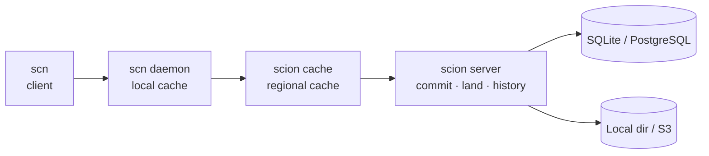

# Scion

English | [简体中文](README.zh-CN.md)

Server-first source control for monorepos, coding agents and CI.

Scion is a Rust implementation of the design in Anthropic's [Redesigning source control](https://www.anthropic.com/engineering/redesigning-source-control): history, merges and rebases are computed on the server, clients stay online and fetch immutable objects on demand, and a checkout holds only the paths a job needs. It ships a server, `scion`, and a client, `scn`, over a language-neutral protocol, and is built by OpenCSG for [starhub-server](https://github.com/OpenCSGs/csghub-server) and CSGLite. 


## Demo: four agents, one branch

[](docs/demo/scion-demo.mp4)

Four agents change one repository at the same time (left), each committing and landing on `main`; the right pane watches `main` on the server. When `main` has moved, the server rebases a commit as it lands (`rebased onto the latest main`, `Your commit X is now Y`). When two agents edit the same lines of `CHANGELOG.md`, the land is refused, and the agent runs `scn sync`, keeps both sides, `scn resolve`, and lands again: every agent's line ends up on `main`. The agents are scripts running real `scn` commands against a server; [docs/demo](docs/demo/README.md) has them and how to record the video ([MP4](docs/demo/scion-demo.mp4)).

## Benchmarks

CSG Scion vs. Git and [CarterT27/scion](https://github.com/CarterT27/scion) on the [OpenScion](https://github.com/tinyhumansai/openscion/blob/main/benchmarks/README.md) workloads, one Apple M5. Median ms, lower is better.

| Scenario | Git, 1k files | CarterT27, 1k | CSG Scion, 1k | Git, 10k files | CarterT27, 10k | CSG Scion, 10k |
| --- | ---: | ---: | ---: | ---: | ---: | ---: |
| Import directory | 365.0 | 32.8 | **30.6** | 3,364.4 | 413.5 | **354.9** |
| Commit one changed file | 28.4 | 29.2 | **13.9** | 250.8 | 142.5 | **35.5** |
| Full clone / checkout | 243.0 | 115.8 | **52.2** | 2,361.9 | 1,047.3 | **589.4** |
| One-directory clone / checkout | 60.3 | 25.0 | **23.1** | 172.9 | 123.1 | **49.5** |

Fastest in every cell: 2–12× faster than Git, 1.1–4× faster than CarterT27/scion on checkouts and commits.

**Real repository:** [pingdotgg/t3code](https://github.com/pingdotgg/t3code), 5,573 commits and 28,068 files; CSG Scion on PostgreSQL and MinIO. The M4 Pro columns are from CarterT27/scion's README.

| Scenario | Git, M5 | CSG Scion, M5 | Git, M4 Pro | CarterT27, M4 Pro |
| --- | ---: | ---: | ---: | ---: |
| Full checkout (28,068 files) | 2.13 s | 2.20 s | 2.90 s | 14.96 s |
| Checkout of `apps/web` (1,521 files) | 0.173 s | 0.178 s | 0.21 s | 0.97 s |
| Clean status | 98 ms | **75 ms** | — | — |
| Full history: Git's clone, Scion's import | 3.96 s | 103 s + 42 s repack | 3.56 s | 23 min 18 s |
| Storage of the history | 557 MB pack | 247 MB in MinIO + 90 MB in PostgreSQL | — | — |

Method and more: [OpenScion workloads](docs/reports/2026-10-20-openscion-workloads.md) · [starhub-server](docs/reports/2026-10-19-starhub-server.md) · [component benchmarks](docs/performance.md)

## How it works



Commits are created and rebased on the server; clients fetch only the files they check out; history needs no clone. Also: `scn import git` with git SHAs kept, ACLs by repository, ref and path, and redaction.

## Quick start

```sh
# Install the client and run the server as a service on 127.0.0.1:7080 (Linux or macOS)
curl -fsSL https://raw.githubusercontent.com/OpenCSGs/scion/main/install.sh | sh -s -- --server

scn repo create http://127.0.0.1:7080/mono
scn clone http://127.0.0.1:7080/mono && cd mono
echo hello > README.md
scn commit -m "add readme"
scn land                          # move main to the commit; the server rebases if main moved
scn log
```

Without `--server`, the script installs only the client, `scn`. From source instead: `cargo run -p scion -- server --lite --data-dir ./.scion-data` and `cargo install --path client/cli`.

**Know git?** Most git commands work in scn as you type them, starting with `scn clone http://host/REPO`: see [git commands in scn](docs/guide/git-commands.md) for the full list.

[A tour of scion and scn](docs/guide/cli.md) goes through the everyday commands, and [coming from git](docs/guide/coming-from-git.md) explains how the model differs. Tools that only speak git can clone, fetch and push the same URL: see [git clients](docs/guide/git-clients.md).

## Deployment

### Option 1: install script (Linux or macOS)

```sh
# Client only
curl -fsSL https://raw.githubusercontent.com/OpenCSGs/scion/main/install.sh | sh
# Client and server, as a service on 127.0.0.1:7080
curl -fsSL https://raw.githubusercontent.com/OpenCSGs/scion/main/install.sh | sh -s -- --server
# For a team: listen on all interfaces with authentication on; prints the first admin token
curl -fsSL https://raw.githubusercontent.com/OpenCSGs/scion/main/install.sh | sh -s -- --server --listen 0.0.0.0:7080
```

Runs under systemd on Linux (data in `/var/lib/scion`) or launchd on macOS (data in `~/Library/Application Support/scion`). `sh install.sh --help` lists the options; [release binaries](docs/guide/deploy.md#release-binaries) covers installing by hand.

### Option 2: Docker, one node (SQLite and a local directory)

```sh
docker run -d --name scion -p 7080:7080 -v scion-data:/data opencsghq/scion:latest
docker exec scion scion admin token create --lite --subject admin --group admins   # shown only once

scn login http://localhost:7080 --token scn_pat_…
scn repo create http://localhost:7080/mono
```

The image is built for `linux/amd64` and `linux/arm64` and requires authentication. Members of `admins` manage the server and anyone signed in can read, write and land; to change that, see [access control](docs/guide/auth.md#access-control-policy).

### Option 3: production (PostgreSQL and S3-compatible storage)

```sh
docker run -d --name scion -p 7080:7080 \
  -e SCION_META=postgres://scion:PASSWORD@db:5432/scion \
  -e SCION_BLOBS=s3://scion-objects -e SCION_S3_ENDPOINT=https://s3.example.com \
  -e SCION_S3_ACCESS_KEY_ID=… -e SCION_S3_SECRET_ACCESS_KEY=… \
  opencsghq/scion:latest --log-format json server --listen 0.0.0.0:7080 --auth-required
docker exec scion scion admin token create --subject admin --group admins
```

Several nodes behind a load balancer share one database and bucket ([clusters](docs/guide/cluster.md)). On one machine, [`deploy/prd`](deploy/prd/docker-compose.yml) starts PostgreSQL, SeaweedFS and the server with authentication required; [`deploy/dev`](deploy/dev/docker-compose.yml) runs the same anonymously, for trials ([deploy.md](docs/guide/deploy.md#docker-compose)).

### Tokens

Each user or CI job signs in once with `scn login SERVER scn_pat_…` (or sets `SCION_TOKEN`). An administrator creates tokens with `scion admin token create --subject alice`, where `alice` is the user's name as commands and policies see it, adding `--group admins` for another administrator or `--ttl 90d` for expiry:

| Deployment | Command |
|---|---|
| install script, Linux | `sudo -u scion scion admin token create --lite --data-dir /var/lib/scion --subject alice` |
| install script, macOS | `scion admin token create --lite --data-dir ~/Library/Application\ Support/scion --subject alice` |
| Docker, one node | `docker exec scion scion admin token create --lite --subject alice` |
| Docker Compose or production | `docker compose exec scion scion admin token create --subject alice` |

With an OIDC provider or a GitHub OAuth app configured, people sign in with `scn login SERVER` in a browser instead. Organizations (`scn org`), personal namespaces and several authorization sources can be combined: the policy, GitHub teams, and webhooks such as starhub or OPA. [Deployment](docs/guide/deploy.md) and [authentication](docs/guide/auth.md) have the details.

## Documentation

| | |
|---|---|
| **Use** | [Deploy](docs/guide/deploy.md) · [CLI tour](docs/guide/cli.md) · [Agents (MCP)](docs/guide/agents.md) · [Git commands](docs/guide/git-commands.md) · [Coming from git](docs/guide/coming-from-git.md) · [Git import](docs/guide/git-import.md) · [Sparse checkout](docs/guide/sparse-checkout.md) · [Repos](docs/guide/repos.md) · [Archives](docs/guide/archive.md) · [Browse](docs/guide/browse.md) · [Git SHAs](docs/guide/git-sha.md) · [git clients](docs/guide/git-clients.md) |
| **Operate** | [Storage](docs/guide/object-storage.md) · [Clusters](docs/guide/cluster.md) · [Caching](docs/guide/cache.md) · [Auth](docs/guide/auth.md) · [Redaction](docs/guide/redaction.md) · [Events](docs/guide/events.md) · [Observability](docs/guide/observability.md) |
| **Design** | [Server](docs/design/rust-server-architecture.md) · [Client](docs/design/rust-client-architecture.md) · [starhub](docs/design/starhub-integration.md) · [Object format](SPEC.md) · [Protocol](proto/scion/v1/) |

## Status

### Working copy

- [x] Clone, status, diff, commit (a subset of paths, or `--amend`), restore, clean, stash
- [x] Pending commits stack; `land` publishes them and the server rebases when the branch has moved
- [x] `sync` rebases each pending commit; conflicts get markers, then `resolve` or `--abort`
- [x] Branches: `switch`, `merge`, detached checkout; revert and cherry-pick
- [x] Lightweight and annotated tags
- [x] `.gitignore` and `.scionignore`
- [x] Sparse checkout (`clone --sparse`, `sparse add|rm|set|disable`)
- [x] Another working copy in seconds (`workspace`, git's worktree)
- [x] Undo of local commands (`undo`, `op log`, `op restore`)
- [x] `import git`, keeping authors, timestamps, git SHAs and annotated tags

### History, without a clone

- [x] `log`, `show`, `blame`, `grep`, `reflog`; `log --follow` across renames
- [x] `cat` and `ls` of any revision; archives (tar.gz, zip, tar)
- [x] Last commit of each directory entry, and directory statistics
- [x] A git SHA on every commit

### Server

- [x] Exactly-once lands, batched when several arrive together; `GetLandStatus` after a timeout
- [x] Repositories: create, list, update, fork, soft-delete and restore; branches and organizations
- [x] Lite (SQLite and a directory) and Standard (PostgreSQL and S3: MinIO, SeaweedFS, AWS)
- [x] Packs, deltas, `admin repack`, and repack on a schedule
- [x] Stateless nodes behind a load balancer; regional cache (`scion cache`) and a local daemon (`scn daemon`)
- [x] Tokens, OIDC device login, GitHub OAuth; ACLs by repository, ref and path; external issuers and an authorization webhook
- [x] Redaction and purge; `admin fsck`
- [x] Ref events (poll, HMAC webhook, NATS) and a pre-land check
- [x] Prometheus metrics, OpenTelemetry tracing, per-caller rate and concurrency limits
- [x] Install script (systemd or launchd), Linux and macOS release binaries, Docker images for amd64 and arm64

### Git clients

- [x] `git clone`, `fetch` and `push` over smart HTTP on the same URL as `scn` (protocol v0 and v2)
- [x] Shallow clones and partial clones (`blob:none`, `blob:limit`)
- [x] Fast-forward push; create, move and delete branches and tags; signed commits keep their SHA

### Agents

- [x] `scn mcp`: read, search, walk history and land with no checkout
- [x] `scn watch`: one line per land
- [x] Several agents on one branch: the server rebases; a land that touches the same lines is refused

### Still open

- [ ] YugabyteDB, and moving metadata between SQLite, PostgreSQL and YugabyteDB
- [ ] Helm chart and chaos tests
- [ ] Git over SSH, `git push --atomic`, submodules
- [ ] A virtual checkout, and status from a file watcher
- [ ] Server-side git import; native large-file storage
- [ ] The starhub-server adapter (the Scion-side APIs are in place); CSGLite embedding the Lite tier
- [ ] Windows builds
- [ ] Interactive rebase, `add -p`, bisect, signed tags

Details: [milestones](docs/design/milestones.md) · [roadmap](docs/design/roadmap.md)

## Development

```sh
cargo test --workspace
cargo clippy --workspace --all-targets -- -D warnings
```

[Development](docs/development.md) describes the repository layout, the dependency rules between crates and the testing requirements (at least 90% coverage of new code).

## License

Apache-2.0
