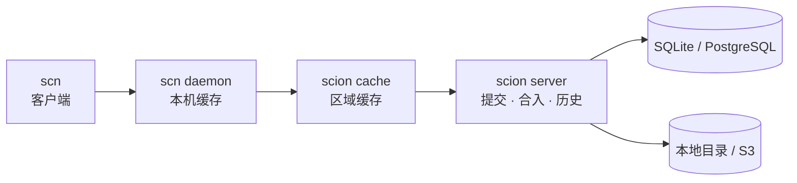

# Scion

[English](README.md) | 简体中文

面向 monorepo、编程 agent 和 CI 的服务端优先的源码管理系统。

Scion 用 Rust 实现了 Anthropic 在 [Redesigning source control](https://www.anthropic.com/engineering/redesigning-source-control) 一文中提出的设计：历史、合并、rebase 都在服务端计算，客户端始终在线、按需获取不可变对象，检出时只拿任务需要的路径。项目提供服务端 `scion` 和客户端 `scn`，协议与语言无关，由 OpenCSG 为 [starhub-server](https://github.com/OpenCSGs/csghub-server) 和 CSGLite 开发。本项目不是 Anthropic 的实现，与 Anthropic 没有关联。


## 演示：四个 agent，一个分支

[](docs/demo/scion-demo.mp4)

四个 agent 同时修改同一个仓库（左侧），各自提交并合入 `main`；右侧实时显示服务端上的 `main`。`main` 已经前进时，服务端在合入时 rebase 提交（`rebased onto the latest main`、`Your commit X is now Y`）。两个 agent 改到 `CHANGELOG.md` 的同一处时，合入被拒绝，agent 执行 `scn sync`、保留双方的改动、`scn resolve`，再次合入：每个 agent 的那一行最终都在 `main` 上。这些 agent 是脚本，对真实的服务端执行真实的 `scn` 命令；脚本和录制方法见 [docs/demo](docs/demo/README.zh-CN.md)（[MP4](docs/demo/scion-demo.mp4)）。

## 性能对比

在 [OpenScion](https://github.com/tinyhumansai/openscion/blob/main/benchmarks/README.md) 的负载上对比 CSG Scion、Git 和 [CarterT27/scion](https://github.com/CarterT27/scion)，同一台 Apple M5。单位毫秒，取中位数，越小越好。

| 场景 | Git，1k 文件 | CarterT27，1k | CSG Scion，1k | Git，10k 文件 | CarterT27，10k | CSG Scion，10k |
| --- | ---: | ---: | ---: | ---: | ---: | ---: |
| 导入目录 | 365.0 | 32.8 | **30.6** | 3,364.4 | 413.5 | **354.9** |
| 提交一个改动的文件 | 28.4 | 29.2 | **13.9** | 250.8 | 142.5 | **35.5** |
| 完整克隆 / 检出 | 243.0 | 115.8 | **52.2** | 2,361.9 | 1,047.3 | **589.4** |
| 只克隆 / 检出一个目录 | 60.3 | 25.0 | **23.1** | 172.9 | 123.1 | **49.5** |

每一项都最快：比 Git 快 2–12 倍，检出和提交比 CarterT27/scion 快 1.1–4 倍。

**真实仓库：** [pingdotgg/t3code](https://github.com/pingdotgg/t3code)，5,573 个提交、28,068 个文件；CSG Scion 用 PostgreSQL + MinIO。M4 Pro 两列取自 CarterT27/scion 的 README。

| 场景 | Git，M5 | CSG Scion，M5 | Git，M4 Pro | CarterT27，M4 Pro |
| --- | ---: | ---: | ---: | ---: |
| 完整检出（28,068 个文件） | 2.13 秒 | 2.20 秒 | 2.90 秒 | 14.96 秒 |
| 检出 `apps/web`（1,521 个文件） | 0.173 秒 | 0.178 秒 | 0.21 秒 | 0.97 秒 |
| 干净工作区的 status | 98 ms | **75 ms** | — | — |
| 完整历史：Git 克隆、Scion 导入 | 3.96 秒 | 103 秒 + repack 42 秒 | 3.56 秒 | 23 分 18 秒 |
| 历史占用的存储 | pack 557 MB | MinIO 247 MB + PostgreSQL 90 MB | — | — |

方法和更多数据：[OpenScion 负载](docs/reports/2026-10-20-openscion-workloads.md) · [starhub-server](docs/reports/2026-10-19-starhub-server.md) · [组件基准测试](docs/performance.md)（均为英文）

## 工作方式



提交在服务端创建和 rebase；客户端只拉检出的文件；查历史不用克隆。另外支持 `scn import git`（保留 git SHA）、按仓库/ref/路径的访问控制，以及 redaction。

## 快速开始

```sh
# 安装客户端，并把服务端作为系统服务运行在 127.0.0.1:7080（Linux 或 macOS）
curl -fsSL https://raw.githubusercontent.com/OpenCSGs/scion/main/install.sh | sh -s -- --server

scn repo create http://127.0.0.1:7080/mono
scn clone http://127.0.0.1:7080/mono && cd mono
echo hello > README.md
scn commit -m "add readme"
scn land                          # 把 main 移到这个提交；main 已前进时由服务端 rebase
scn log
```

不加 `--server` 时只安装客户端 `scn`。也可以从源码运行：`cargo run -p scion -- server --lite --data-dir ./.scion-data` 和 `cargo install --path client/cli`。

**熟悉 git？** 大多数 git 命令在 scn 里可以照原样输入，从 `scn clone http://host/REPO` 开始，完整列表见 [scn 中的 git 命令](docs/guide/git-commands.zh-CN.md)。

[scion 与 scn 使用导览](docs/guide/cli.zh-CN.md)介绍日常命令，[从 git 迁移](docs/guide/coming-from-git.zh-CN.md)说明两者模型上的区别。只会说 git 的工具可以用同一个 URL 克隆、拉取和推送，见 [git 客户端](docs/guide/git-clients.zh-CN.md)。

## 部署

### 方式一：安装脚本（Linux 或 macOS）

```sh
# 只装客户端
curl -fsSL https://raw.githubusercontent.com/OpenCSGs/scion/main/install.sh | sh
# 客户端和服务端，服务运行在 127.0.0.1:7080
curl -fsSL https://raw.githubusercontent.com/OpenCSGs/scion/main/install.sh | sh -s -- --server
# 给团队用：监听所有网卡并开启认证，打印第一个管理员令牌
curl -fsSL https://raw.githubusercontent.com/OpenCSGs/scion/main/install.sh | sh -s -- --server --listen 0.0.0.0:7080
```

Linux 上由 systemd 管理（数据在 `/var/lib/scion`），macOS 上由 launchd 管理（数据在 `~/Library/Application Support/scion`）。`sh install.sh --help` 列出全部选项；手动安装见 [release 二进制](docs/guide/deploy.zh-CN.md#release-二进制)。

### 方式二：Docker 单节点（SQLite + 本地目录）

```sh
docker run -d --name scion -p 7080:7080 -v scion-data:/data opencsg-registry.cn-beijing.cr.aliyuncs.com/opencsghq/scion:latest
docker exec scion scion admin token create --lite --subject admin --group admins   # 令牌只显示这一次

scn login http://localhost:7080 --token scn_pat_…
scn repo create http://localhost:7080/mono
```

镜像支持 `linux/amd64` 和 `linux/arm64`，默认要求认证。`admins` 组的成员管理服务端，任何已登录的身份都可以读写、合入；要修改，见[访问控制策略](docs/guide/auth.zh-CN.md#访问控制策略)。

### 方式三：生产环境（PostgreSQL + S3 兼容存储）

```sh
docker run -d --name scion -p 7080:7080 \
  -e SCION_META=postgres://scion:PASSWORD@db:5432/scion \
  -e SCION_BLOBS=s3://scion-objects -e SCION_S3_ENDPOINT=https://s3.example.com \
  -e SCION_S3_ACCESS_KEY_ID=… -e SCION_S3_SECRET_ACCESS_KEY=… \
  opencsg-registry.cn-beijing.cr.aliyuncs.com/opencsghq/scion:latest --log-format json server --listen 0.0.0.0:7080 --auth-required
docker exec scion scion admin token create --subject admin --group admins
```

多个节点放在负载均衡后面，共用一个数据库和 bucket（见[多节点](docs/guide/cluster.zh-CN.md)）。单机部署用 [`deploy/prd`](deploy/prd/docker-compose.yml)，它会启动 PostgreSQL、SeaweedFS 和必须认证的服务端；[`deploy/dev`](deploy/dev/docker-compose.yml) 以匿名方式运行同样的组件，用于试用（见 [deploy.md](docs/guide/deploy.zh-CN.md#docker-compose)）。

### 令牌

每个用户或 CI 任务登录一次：`scn login 服务端地址 scn_pat_…`（或设置 `SCION_TOKEN`）。管理员用 `scion admin token create --subject alice` 签发令牌（`alice` 换成实际用户名，命令和策略里看到的就是它），加 `--group admins` 是另一个管理员，加 `--ttl 90d` 按期过期：

| 部署方式 | 命令 |
|---|---|
| 安装脚本，Linux | `sudo -u scion scion admin token create --lite --data-dir /var/lib/scion --subject alice` |
| 安装脚本，macOS | `scion admin token create --lite --data-dir ~/Library/Application\ Support/scion --subject alice` |
| Docker 单节点 | `docker exec scion scion admin token create --lite --subject alice` |
| Docker Compose 或生产环境 | `docker compose exec scion scion admin token create --subject alice` |

配置了 OIDC 或 GitHub OAuth app 时，用户直接 `scn login 服务端地址`，在浏览器里登录。组织（`scn org`）、个人命名空间和多种授权来源可以组合使用：策略、GitHub team，以及 starhub、OPA 这类回调。详见[部署](docs/guide/deploy.zh-CN.md)和[认证](docs/guide/auth.zh-CN.md)。

## 文档

| | |
|---|---|
| **使用** | [部署](docs/guide/deploy.zh-CN.md) · [命令导览](docs/guide/cli.zh-CN.md) · [Agent（MCP）](docs/guide/agents.zh-CN.md) · [git 命令](docs/guide/git-commands.zh-CN.md) · [从 git 迁移](docs/guide/coming-from-git.zh-CN.md) · [git 导入](docs/guide/git-import.zh-CN.md) · [稀疏检出](docs/guide/sparse-checkout.zh-CN.md) · [仓库与分支](docs/guide/repos.zh-CN.md) · [打包下载](docs/guide/archive.zh-CN.md) · [文件列表](docs/guide/browse.zh-CN.md) · [git SHA](docs/guide/git-sha.zh-CN.md) · [git 客户端](docs/guide/git-clients.zh-CN.md) |
| **运维** | [存储](docs/guide/object-storage.zh-CN.md) · [多节点](docs/guide/cluster.zh-CN.md) · [缓存](docs/guide/cache.zh-CN.md) · [认证](docs/guide/auth.zh-CN.md) · [redaction](docs/guide/redaction.zh-CN.md) · [事件](docs/guide/events.zh-CN.md) · [可观测性](docs/guide/observability.zh-CN.md) |
| **设计** | [服务端](docs/design/rust-server-architecture.zh-CN.md) · [客户端](docs/design/rust-client-architecture.zh-CN.md) · [starhub](docs/design/starhub-integration.zh-CN.md) · [对象格式](SPEC.zh-CN.md) · [协议](proto/scion/v1/) |

## 进度

- [x] M1–M4：写入与工作区、历史查询、服务端合入、多节点、缓存
- [ ] M5 生产化：认证、redaction、可观测性、事件、打包和发布构建已完成；还剩 YugabyteDB 和 Helm

详见：[里程碑](docs/design/milestones.md) · [路线图](docs/design/roadmap.md)

## 开发

```sh
cargo test --workspace
cargo clippy --workspace --all-targets -- -D warnings
```

[开发说明](docs/development.md)（英文）介绍目录结构、crate 之间的依赖规则和测试要求（新代码覆盖率至少 90%）。

## 许可证

Apache-2.0
